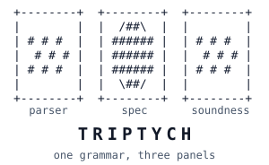

# Triptych



Triptych is a Lean 4 grammar-to-parser compiler for acyclic, non-recursive string formats. From
one grammar, it generates a readable specification, a verified parser, and machine-checked
correctness theorems.

For more details, see the [Triptych documentation](https://cruisesong7.github.io/triptych/).

## Build

```sh
lake build
```

## Check generated Verus snapshots

The drift checker regenerates every `verus` clause in memory and compares the resulting
`spec.rs`, `parser.rs`, and generated `contract.rs` with the checked-in files:

```sh
lake exe triptych -- check-verus cedar-examples/Inputs/Decimal.lean
```

The default comparison ignores whitespace and comments outside literals while preserving the
complete Rust/Verus token stream. Use `--exact` for byte-for-byte comparison. The command is
read-only: Triptych also suppresses the declaration's `to`-clause writes while checking, and exits
nonzero for missing, stale, or modified generated artifacts.

## Check the Verus translation through Vermilion

A developer-only semantic roundtrip guard for work on the Verus backend sends the exact generated `spec.rs` through an external
Vermilion checkout and kernel-checks deterministic equivalence obligations against Triptych's
original Lean specification:

```sh
lake exe triptych -- check-verus-roundtrip \
  --vermilion-root /path/to/vermilion \
  cedar-examples/Inputs/Decimal.lean
```

Format authors never need to run it. The command requires a developer-maintained proof at
`verus-experiments/vermilion-roundtrip/proofs/TriptychVermilionProofs/Decimal.lean`. It first performs the exact snapshot
check, requires matching Lean toolchains, and rejects any theorem that depends on an axiom other than `propext`, `Classical.choice`, and
`Quot.sound`.
Generated obligations pin every recovered view slot to the corresponding named Triptych capture
and equate the recovered `*_matches_result` relation with source validity plus `computeValue`.
